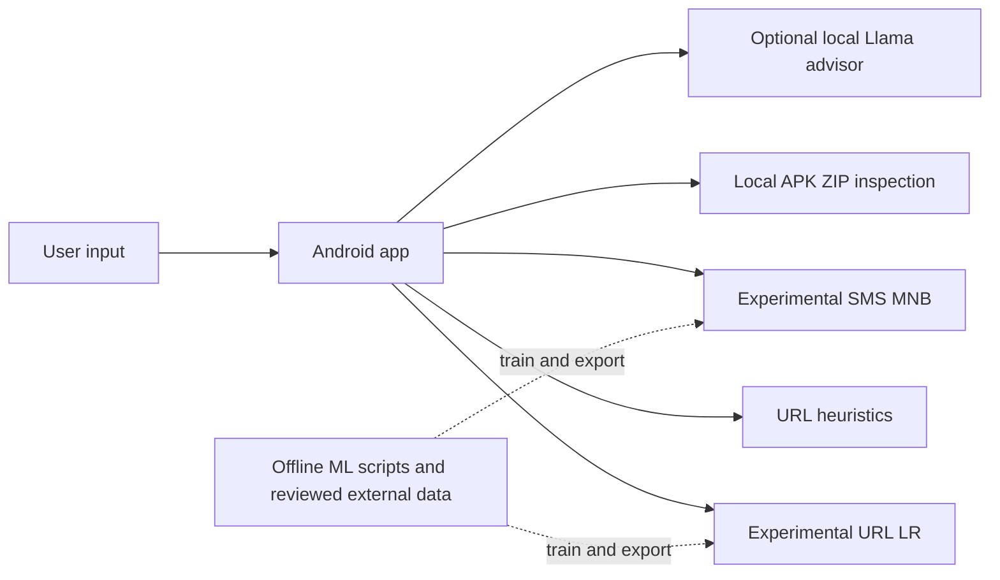

<p align="center">
  
</p>

<p align="center"><strong>Offline-first Android tools for inspecting suspicious links, messages, and APK archives.</strong></p>

Don'tClik keeps its URL and pasted-message analysis on the device. Its experimental classifiers are research prototypes: they do not establish that a link or message is safe, or confirm that it is malicious. The optional Llama advisor runs locally after a compatible model is configured.

## What the app does

- **URL scanning:** deterministic structural indicators, shown separately from an optional experimental Logistic Regression assessment.
- **SMS patterns:** user-pasted text is compared with an experimental spam/ham model. It is not a verified scam detector, does not read the inbox, and does not block or save messages.
- **APK inspection:** a user-selected APK is inspected locally for bounded ZIP structure, DEX/native library counts, and conservative archive indicators. This is not malware detection; the file is never installed or executed.
- **On-device advisor:** optional Llama 3.2 1B inference through ExecuTorch. Model files are supplied and configured separately; scanner inputs are not sent to Llama.

Classifier labels are assessments, not calibrated threat probabilities. The URL model lacks representative, independently verified benign HTTPS validation. The SMS model has known false-positive risk on banking and OTP-like messages and does not support non-ASCII text. See the [model cards](docs/MODEL_CARD_PHISHING.md) and [SMS model card](docs/MODEL_CARD_SMS.md).

## How it is organized



The app presents the deterministic URL findings independently of the optional classifier output. SMS analysis requires a deliberate paste action. APK inspection reads archive metadata only. The experimental ML assets are not included in this repository, so those assessments report unavailable until a user provisions compatible, rights-reviewed files locally.

## Android development

Open [`android/`](android/) in Android Studio. Keep the checked-in Gradle wrapper, root Gradle files, version catalog, and `app/` module together. Set the local Android SDK path in an untracked `android/local.properties` file or let Android Studio configure it.

From PowerShell in `android/`, build and run JVM tests with dependencies already available locally:

```powershell
.\gradlew.bat --offline --no-daemon :app:testDebugUnitTest
.\gradlew.bat --offline --no-daemon :app:assembleDebug
```

The app can build without the optional phishing and SMS classifier assets. Model-dependent tests and assessments need those assets. For authorized local experiments only, place `phishing_lr_v1.model` and `sms_spam_v1.model` in a reviewed directory, then run:

```powershell
.\provision_ml_assets.ps1 -AssetDirectory 'C:\path\to\reviewed-assets'
```

The script refuses to overwrite existing assets; the resulting `.model` files are Git-ignored. No training datasets, classifier artifacts, Llama weights, or tokenizer are distributed here. Obtain compatible local artifacts only where their provenance and redistribution terms permit use. For Llama setup and additional build notes, see the [Android guide](android/README.md) and [build/test notes](docs/ANDROID_BUILD.md).

## Testing and evidence

The repository includes JVM tests for URL heuristics, model loading/parity, SMS analysis, APK archive inspection, advice selection, and UI state. Run the commands above for reproducible local checks. Model-dependent tests require the ignored local assets; device/model-download tests require their own configured fixtures and device.

The publication preparation record documents a previous offline JVM run (31 tests passed) and debug build. Instrumented UI tests were not run for that source preparation. A later local Motorola Edge 40 Neo smoke check, using privately provisioned classifier assets, observed a benign-like output for `https://google.com` (score `0.4056`, threshold `0.4567`) and a spam-like output for a synthetic prize message. These are single manual demonstrations, not accuracy evidence or reproducible public test fixtures. The local APK and model assets were not published.

## Boundaries

- URL and SMS models are experimental and have known dataset coverage limitations; neither provides a verified verdict.
- SMS input is user-pasted only; there is no inbox access, automatic blocking, deletion, or forwarding.
- APK analysis is bounded static ZIP metadata inspection. It does not inspect runtime behavior or determine whether an APK is malicious.
- Network monitoring and SMS monitoring are not implemented.
- Llama inference is on-device when a compatible model is configured, but model weights and tokenizer files are not included.
- Do not use this prototype as the sole basis for security decisions.

## Repository map

```text
android/       Compose app, Gradle wrapper, tests, local asset provisioner
ml/phishing/   URL dataset audit, training, analysis, export and parity code
ml/sms/        SMS experiments, diagnostics, export and Kotlin parity prototype
ml/malware/    APK static-inspection scope and limitations
data/          Dataset placement guidance; raw datasets are excluded
docs/          Architecture, build, privacy, provenance and model cards
LICENSES/      Preserved third-party license and notice files
```

## Licensing and attribution

The root [MIT license](LICENSE) applies to project-owned code as described there. The Android app is derived from Meta's ExecuTorch Android Llama Demo; its applicable upstream notice is preserved in [`LICENSES/EXECUTORCH_LICENSE`](LICENSES/EXECUTORCH_LICENSE), and source headers remain in place. See [third-party notices](docs/THIRD_PARTY_NOTICES.md) and [`NOTICE.md`](NOTICE.md).

MIT does not relicense third-party libraries, datasets, trained models, Llama weights, or tokenizer files. Those artifacts are excluded and remain subject to their own terms. The project does not imply Meta endorsement.
